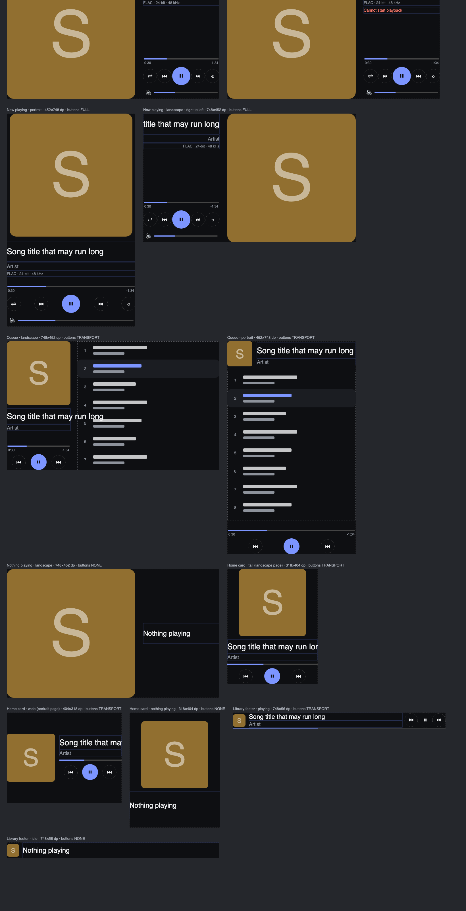

# 30 · 播放器界面：音频页、资料库与首页卡片

> 2026-11-02。用户说多媒体的 UI 需要完善，并附了 13 张截图；**截图文件在我这边打不开，没有看到**，所以下面的“现状”是读代码得出的。**没有在真机上看过新界面**：这次整个过程中设备没有连上 adb。写这份文档时的验证只有自动测试和一张布局示意图，见 §5。
> 标记：**已核对** = 读过代码或跑过测试；**未验证** = 要上真机才知道。决策见 ADR-036。
> 先读：`AGENTS.md` → `27-streaming.md`（播放器本身）→ `22-player-plan.md`（最初的界面规划与原型）→ 本文。

## 1. 现状（读代码得出，已核对）

| 页面 | 以前的样子 |
|---|---|
| 音频页 `player.audio` | `focus` 版式把四样东西垂直堆在一起：曲名、艺术家、进度条、上一首/播放/下一首。没有封面、没有队列、没有音量、没有格式信息；只有一个版面，不能上下滑切换 |
| 资料库 `player.library` | 页面顶端是一行**标题**，点它才切换“音乐 / 视频 / 最近 / 网络流”（列表占用了纵向拖动，所以没法用变体手势）；列表是平铺的行，看不出哪首在播；底部一行灰字提示“点标题切换到…” |
| 首页卡片 `player.now` | 一行小字“播放器”、曲名、三个按钮；没有封面也没有进度 |
| 视频页 | 已经比较完整（影院视图、字幕、手势），这次没改 |

## 2. 这次做了什么

用**一个** OS 组件 `nowplaying`（API 8）画三种样式，再配两个小零件。插件只声明“放哪种样式、空闲时写什么字、有什么提示”，其余都归 OS（ADR-017）。

| 部分 | 内容 |
|---|---|
| `nowplaying` · `full`（音频页） | 封面；曲名（最多两行，自动缩小）、艺术家、**格式行**（如 `FLAC · 24-bit · 48 kHz`、`MP3 · 320 kbps · 44.1 kHz`，只写解码器报告过的）；位置条；随机 / 上一首 / 播放 / 下一首 / 循环（关 → 全部 → 单曲）；**系统音量条**；播放错误作为一行提示显示在格式行下面 |
| 变体 | `cover`（上面这些）和 `queue`（窄栏放封面、曲名、位置条和三个按钮，宽栏是队列）；上下滑切换，OS 画变体指示点 |
| 队列 | 取自播放引擎（`MediaEngine.queueEntries()`），**不经过 Lua 状态**；正在播放的行高亮并带三根小柱，点一行直接跳播（`engine.jump`） |
| `nowplaying` · `bar` | 资料库页脚的一行迷你播放器：缩略封面、两行文字、上一首/播放/下一首，底边一条进度线；空闲时显示页脚提示 |
| `nowplaying` · `card` | 首页卡片：封面、曲名、艺术家、进度线、三个按钮；横竖两种形状 |
| `tabs` | 四个标签代替“点标题切换”；每个标签是真正带文字的视图，所以读屏和 UI 测试都能按文字找到并按下 |
| `list.current` | 列表把当前行（正在播放的那首）高亮，变化时自动滚到可见位置；资料库在 4 个列表里都标出正在播放的行 |
| 封面 | 有图就用图（走和图片组件同一套下载、缓存和限制）；**没有图就按曲名画一张**：颜色由曲名决定（同一首歌永远同一个颜色）、首字母放大淡出、艺术家名在左上 |
| 配色 | 进度条、播放键、当前行取封面的色相；按对比度求解明暗，图形 ≥ 3:1、文字 ≥ 4.5:1 |
| 手势 | 轻点封面 = 暂停/继续；按钮、位置条、音量条、队列归原生控件；其余地方（封面以外的空白、文字）归舞台：上下滑切变体、长按进设置；音频页是接管页，左右滑不再翻页，用返回（最左缘右滑、Back 键）退出（ADR-040）。位置条与音量条的横向拖动不会被抢去 |

## 3. 排版（`ui/NowPlayingModel.kt`，纯函数，JVM 里测过）

尺寸是页面内容区（扣掉 20 dp 页边距后）的 dp：横屏 748×452，竖屏 452×748。

- **cover · 横屏**：封面是和页面一样高的正方形，右边一栏（≈268 dp）：上面曲名/艺术家/格式行，**下面**位置条、五个按钮（贴边）、音量条。中间的空白是留给以后的歌词/频谱的。
- **cover · 竖屏**：封面在上，宽度接近满宽（至少 70%），其余在下。高度不够时依次放弃：曲名第二行 → 格式行 → 音量条；再不够就缩小封面。
- **queue · 横屏**：左栏 196–232 dp（封面、曲名、位置条、三个按钮），右边是队列。**竖屏**：顶部一条 88 dp 的封面 + 曲名，中间队列，底部位置条和按钮。
- **空闲**（没有播放）：只有封面和一行“没有在播放”，没有按钮和位置条。
- **太小**：整页放不下时退回迷你条样式；按钮不足 40 dp 就不画。
- **右到左语言**：整体镜像（封面在右、文字右对齐），按钮次序和位置条仍然从左到右。

## 4. 接口（API 8，详见 `06-plugins.md` §4.1.2）

- 组件 `nowplaying`：`style`、`idle`、`notice`；**需要 `media` 权限**（Kotlin 的 `MediaViews`、Python 打包器、Go 校验三处都加了）。
- 组件 `tabs`：`items`（状态里的字符串数组，最多 6 项）、`current`（1 起）、`tap`（以 `(name, index)` 发给插件）。
- `list.current`。
- `player` 插件 0.3.0：`views/audio.json` 声明两个变体；`views/library.json` 用 `tabs` + `list` + `nowplaying bar`；`views/now.json` 是卡片样式。状态新增 `tabs`、`tab`、`current`；`footer` 现在只放真正的提示（空目录、播放失败），不再放“点标题切换”。`tap "cycle"` 保留以兼容旧测试。
- 触摸分流：`RenderComponent.interactiveAt(x, y)`（默认等于 `interactive`），让一个组件只在**部分区域**归原生控件。这是封面区仍然能上下滑切变体的前提。

## 5. 验证

**自动检查（2026-11-02，已跑）**

- JVM 单元测试 512 项，0 失败（1 项是只在设置了环境变量时才导出布局的预览，默认跳过），`lintDebug`、`assembleDebug` 通过；APK 里只有 armv7 的原生库（`libffmpegJNI.so`、`libthinkos_playfair.so`、`libtos.so`）。
- 其中 `NowPlayingModelTest`（13 项）：360 个色相 × 5 档饱和度 × 深浅两种背景，强调色（图形）≥ 3.0:1、强调文字 ≥ 4.5:1；绘制封面上的白字 ≥ 4.5:1；格式行；标签点击位置；**12 种页面尺寸 × 两种密度 × 左右方向 × 有无提示 × 播放/空闲**，每个部分都在范围内且互不重叠，按钮 ≥ 40 dp 且互不重叠。
- 原生 Lua 测试 97 项全过（新增：标签切换、当前行跟随播放）；Python 40 项、Go 协议测试、`gen_android_strings.py --check`（11 种语言 × 159 条）通过。

**布局示意图**：`docs/figures/player/native-arrangement.png`（由 `NowPlayingPreviewTest` 导出方块位置，`tools/layout_preview.py` 画成图）。**它只表示各部分的位置和大小**，字体、真实配色、封面图、动画都没有。



**未验证（都要上真机）**

- 真实的字体、间距和配色；曲名自动缩小在中文长标题下是否好看。
- 触摸分流：封面区上下滑是否真的切到队列、位置条/音量条拖动是否不被翻页抢走、队列里竖向滚动、轻点封面暂停。
- 音量条改的是系统音量（用 `media volume` 读回）；封面图加载；队列跳播。
- 横竖屏、浅色/深色/夜间红色下的实际观感；`NIGHT` 没有专门设计（红色滤镜叠在整个页面上，封面也会变红）。
- 性能：没有测。位置条每 200 ms 重画一次（沿用视频的做法），迷你条/卡片的进度线每 500 ms，音量条每秒读一次系统音量。按约定，等界面在真机上确认能用之后再测，并提前告诉用户。
- 其他语言和 RTL 下的文字。

**真机验证**（设备连上之后）：

```bash
export ADB_MDNS=0
cd android && JAVA_HOME=$(/usr/libexec/java_home -v 17) ./gradlew assembleDebug && cd ..
tools/deploy.sh --no-build            # 或 adb install -r …/app-debug.apk
python3 -I tools/tests/player_ui_device.py        # 截图在 artifacts/player-ui/；需要 /sdcard/Music 里至少两首歌
python3 -I tools/tests/player_device.py           # 旧的整条流程测试，已改成用标签；需要 tools/media/gen_samples.sh 的样片
```

`player_ui_device.py` **还没有跑过**（写的时候设备不在线），第一次运行时可能要修脚本本身。它会播放音乐、改动媒体音量（结束时恢复），并在两个方向、两个主题下截图。

## 6. 没做 / 下一步

1. **歌词**：同名 `.lrc`（需要新的 `tos.library.read`）、LRCLIB 在线查词（默认关）；`lyrics` 组件，当前行由 OS 按播放位置算。见 `22-player-plan.md` §6。
2. **频谱**：`TeeAudioProcessor` + FFT；帧率要单独评估（时钟优先，见 `22-player-plan.md` §8）。横屏封面页右栏中间的空白就是它的位置。
3. **嵌入封面**：本机 4 首歌没有任何标签和封面，所以默认看到的是按曲名画的封面。读 ID3 / FLAC 里的图要给 `image` 加 `embedded:` 来源。
4. **按封面染背景**（`mood`）：OS 还不消费 `mood`。
5. 旧字符串 `hint.cycle`（11 种语言）已经没有人用，可以删。
6. API 8 编号已统一：操作栏和音乐界面都在 API 8，尚未公开发布。

## 7. 文件

| | |
|---|---|
| 排版、配色、格式行（纯函数） | `android/app/src/main/java/moe/kiwi/thinkos/ui/NowPlayingModel.kt` |
| 视图（封面、位置线、音量条、队列、主组件） | `ui/NowPlaying.kt` |
| 标签页 | `ui/Tabs.kt` |
| 按钮（新增随机/循环图标、圆形底） | `ui/MediaWidgets.kt` |
| 工厂与按钮动作 | `ui/MediaComponents.kt`（`nowplaying` 需要 `CoverLoader`，由 `RuntimeHost` 接上图片管线） |
| 触摸分流 | `ui/RenderComponent.kt`、`ui/PageView.kt` |
| 契约 | `shared/schema/plugin/layouts.json`、`manifest.json`（生成的 `PluginSchema.kt`、`plugin_generated.go` 不要手改） |
| 插件 | `plugins/player/`（`main.lua`、`views/`） |
| 测试 | `ui/NowPlayingModelTest.kt`、`ui/NowPlayingPreviewTest.kt`、`plugin/PluginSchemaTest.kt`、`tools/tests/player_test.lua`、`test_plugin_packages.py`、`server/internal/protocol/render_api_test.go`、`tools/tests/player_ui_device.py` |
